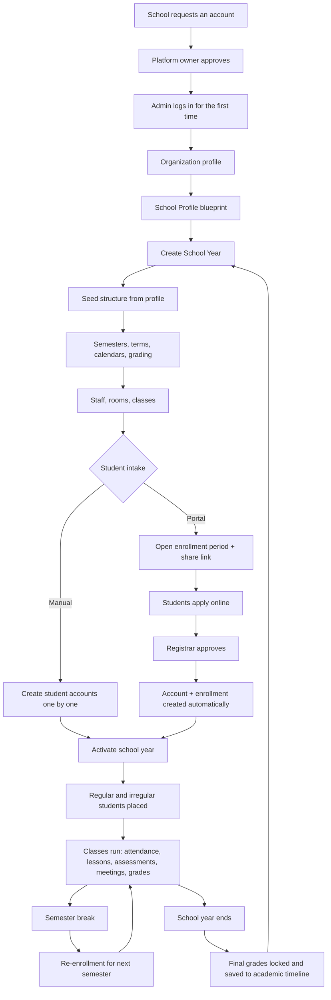

# ReliefEd — The School Journey

A plain-language walkthrough of everything a school does in ReliefEd, from the day the owner asks for an account to the day the school year closes and grades are archived.

> **Who this is for:** school owners, administrators, registrars, and anyone who needs to understand the product end-to-end without reading code.
>
> **How to read it:** each phase lists what the school does, what the system does in response, and when the phase is "done". The phases are incremental — you cannot skip ahead, because each one feeds the next.

---

## The three big ideas

1. **The School Profile is a reusable blueprint.** Departments, courses, strands, levels, sections, subjects, grading scales, and grading schemes are configured once per department type, then reused to seed every new school year.
2. **A School Year is a working copy.** Each year gets its own programs, levels, sections, subjects, semesters, terms, calendars, classes, and people — seeded from the profile, then adjusted for that year.
3. **Enrollment is self-service by default.** Students apply through a public link. The registrar only reviews and approves — approval creates the student account and enrollment automatically, instead of typing each student in one by one.

---

## Actors at a glance

| Actor | What they own |
| --- | --- |
| **Platform owner** | Reviews school registration requests, approves/rejects them, sends credentials. |
| **School owner / Admin** | Sets up the organization, school profile, school year, calendars, staff, students, and runs the year. |
| **Registrar** | An admin account flagged as registrar. Reviews enrollment applications and manages student records. |
| **Educator** | Teaches classes, records attendance, creates lessons/assessments, enters grades, hosts meetings. |
| **Student** | Applies for enrollment, views classes and lessons, submits work, joins meetings, checks grades. |
| **Applicant (future student)** | Uses the public enrollment portal before having an account. |

---

## Big-picture flow

---

## Phase 0 — Requesting access

**Goal:** a school that has never used ReliefEd gets its first admin account.

1. The school owner opens the public registration page and submits a request with:
   - Full name and personal email
   - Institution name
   - Role in the school
   - Estimated student count
   - Programs/departments offered
   - Preferred plan
2. The request lands in the **Platform Owner** review queue as `pending`.
3. The platform owner can:
   - **Approve** — the system generates a login email (for example `admin.<school-domain>`) and a temporary password, creates the **admin account + profile**, and emails the credentials to the applicant's personal email. No organization exists yet — that is the admin's first job after logging in.
   - **Reject** — the request is closed.
   - **Request revision** — the applicant is asked to correct or complete details, then re-submits.
4. The applicant receives credentials and can log in.

**Phase is done when:** the school owner can log in as an admin.

---

## Phase 1 — First login and organization setup

**Goal:** the school exists inside ReliefEd as a tenant.

On first login the admin has no organization attached, so the system routes them into organization setup.

1. **Create the organization profile:**
   - School name, description, address, logo
   - Email extension (for example `@relief-ed.ph`) used to generate student and staff login emails
   - Organization slug
2. **Organization-level defaults:**
   - **Enrollment settings** — whether students must re-enroll each semester, whether students are auto-unenrolled at year end, the default outcome when a student shifts out, and whether educators may override grading schemes.
   - **Schedule settings** — school start and end time, slot duration, active weekdays, and recurring breaks such as lunch or recess.

**Phase is done when:** the organization profile and its defaults are saved. Everything after this is scoped to this organization only.

---

## Phase 2 — Building the School Profile (the reusable blueprint)

**Goal:** describe the school's academic structure once so future school years can be seeded from it.

The **School Profile** is a template, not a live year. It holds:

1. **Departments** — daycare, kinder, elementary, junior high, senior high, college, and so on.
2. **Courses** — for departments that use courses (for example BSIT, BSCS, BSBA).
3. **Strands** — for senior high tracks.
4. **Levels** — grade levels or year levels, ordered, and attached to a course or strand where applicable.
5. **Sections** — named sections with capacities under each level.
6. **Subjects** —
   - **Major subjects** tied to a specific level.
   - **Minor / shared subjects** tied to a department and shared across courses or strands, without duplicating the subject row.
7. **Grading scales** — numeric or letter ranges per program type.
8. **Grading schemes** — how final grades are computed from components (written work, performance tasks, exams, and so on).
9. **Semester and term configuration** — how many semesters and terms each program type uses.

There is an organization switch — **auto-seed new school years** — that decides whether new years are seeded automatically from this profile or whether the admin is prompted after each year is created.

**Phase is done when:** the profile describes the real school structure and the admin is confident it can be reused.

---

## Phase 3 — Creating the school year

**Goal:** turn the blueprint into a working academic year.

1. The admin creates a **School Year** with a name and start/end dates. It starts as `pending`.
2. The admin chooses one of two paths:
   - **Seed from the School Profile** — departments, programs, courses, strands, levels, sections, subjects, grading scales, and grading schemes are copied into the year.
   - **Create manually** — the admin builds the year's structure directly, for schools that change structure every year.
3. Semester templates are assigned to each program, with real start and end dates for every semester and term. This is what makes "first sem", "second sem", and their terms concrete for the year.
4. The year's structure is reviewed: levels, sections, subjects, and capacities for *this* year.

**Phase is done when:** the school year has a complete structure and dated semesters/terms.

---

## Phase 4 — Academic calendar and grading setup

**Goal:** make the year's time and grading rules explicit.

1. **Academic calendars per program** — term windows, breaks, and holidays.
2. **Organization holidays** — shared non-class days.
3. These calendars drive session blocking: the system knows which dates cannot hold classes or attendance sessions.
4. **Grading scales and schemes are assigned** to the year's programs and levels, so grades computed during the year follow the correct rules.

**Phase is done when:** every program has a calendar covering its semesters and terms, and grading rules are assigned.

---

## Phase 5 — Staff, rooms, and classes

**Goal:** the people and spaces needed to run classes exist.

1. **Educator accounts** are created by the admin (individually or in batches).
   - Each educator gets a profile, login email, and password.
   - Educators are tagged with the **subjects they can teach**, so class generation and assignment only pick qualified teachers.
   - A schedule profile can be attached to respect availability.
2. **Registrar access** is granted by flagging an admin account as registrar. Registrars handle enrollment applications and student records.
3. **Rooms** are created with capacity and scheduling constraints.
4. **Classes** are created per subject, level/section, and school year, with:
   - Assigned educator
   - Schedule (days, time slots, room)
   - Capacity
5. A **class generator** can propose or create class blocks from the year's structure, reducing manual setup.

**Phase is done when:** every subject that will run this year has a class, a teacher, a schedule, and (where relevant) a room.

---

## Phase 6 — Student intake

**Goal:** students exist in the system and are enrolled for the year.

There are two paths. Most schools use both: the portal for new students, manual entry for walk-ins and corrections.

### Path A — Manual creation (one by one)

1. The admin or registrar creates a student account.
2. The system builds the login email from the student's email name plus the organization's email extension.
3. The student is enrolled into the school year, then into a program, level, and section.
4. This is reliable but slow at scale, and is best kept for exceptions.

### Path B — Enrollment portal (recommended for intake)

1. The admin creates an **Enrollment Period** for the school year:
   - Name
   - Start date, end date, and **lock date**
   - A public **token link** to share
   - A **section overflow rule**: auto-create a new section, expand an existing section's capacity, or accept the student without a section for later assignment
2. The school shares the link on its website, social pages, or printed materials.
3. An applicant opens the link and:
   - Verifies their personal email with a one-time code
   - Fills in personal details, previous school, and contact information
   - Chooses program, course/strand, and level (and a section if allowed)
   - Submits the application and receives an **application code**
4. The applicant can return to check status, and can edit until the period locks.
5. At the lock date, applications are locked automatically. Late edits require the registrar to unlock a specific application.
6. The registrar opens the **enrollment dashboard** and reviews applications:
   - **Approve** — in one transaction the system creates the student account, profile, school-year enrollment, program enrollment, and section assignment (following the overflow rule). Credentials are issued for the new student.
   - **Reject** — with a reason.
   - **Unlock** — send a locked application back for correction.
7. Approved students appear immediately in the student roster for the year — no retyping.

**Phase is done when:** the roster for the school year is complete and every student has an account and an enrollment.

---

## Phase 7 — Before the school year starts

**Goal:** the year is ready to open and students are placed correctly.

1. The admin runs the **readiness check**. The system verifies the year has what it needs (structure, calendars, grading setup, and so on).
2. The admin **activates the school year**. Only one year is active at a time.
3. Students are classified:
   - **Regular** — following a full block of subjects for their level/section.
   - **Irregular** — carrying a customized load, often because of failed, dropped, shifted, or credited subjects.
4. **Irregular students choose their subjects/classes.** Their selection is submitted as a request flagged for review:
   - `pending_review` — waiting on the admin
   - `ready` — reviewed and approved for finalization
   - Finalizing creates the actual class enrollments.
   - Prerequisite warnings are shown when a student picks a subject they may not yet be eligible for.
5. Announcements and notifications go out to staff and students.

**Phase is done when:** the year is active, every student has a class load, and teachers can see their rosters.

---

## Phase 8 — Running the school year (per semester and term)

**Goal:** teaching, learning, and grading happen inside ReliefEd.

For each class, across each semester and term:

1. **Attendance** — sessions are opened and records are recorded per student. Blocked calendar dates are respected.
2. **Lessons and concepts** — educators publish lesson content.
3. **Presentations** — slide decks are created and shared.
4. **Assessments** — quizzes, activities, and exams are created with questions and scoring rules.
5. **Submissions** — students submit work; educators review and score.
6. **Grades** — computed from the assigned grading scheme, or entered manually where the scheme allows it.
7. **Meetings** — video class sessions are scheduled and joined; invitations and join requests are handled.
8. **Communication** — class group messaging, polls, and reactions; concerns can be raised and tracked.
9. **Grade locks** — grading deadlines can lock a class. After the deadline, grades cannot change until an unlock is requested and granted, and every lock/unlock is logged.
10. **Reports** — dashboards, analytics, exports, and transcripts reflect live data.

**Phase is done when:** the semester's terms are complete and grades are finalized and locked.

---

## Phase 9 — Semester break and re-enrollment

**Goal:** close one semester cleanly and open the next.

1. Grades for the semester are finalized and locked.
2. The semester ends and the break period runs according to the academic calendar.
3. If the organization requires **semester re-enrollment**, the admin re-enrolls continuing students for the next semester.
4. Students choose the subjects/classes they want to take. Their choices are **flagged for admin review**, exactly like irregular student requests.
5. The admin reviews, adjusts, and finalizes the requests, producing the next semester's class loads.
6. Classes resume with updated rosters.

**Phase is done when:** the next semester's enrollments are finalized and classes can continue.

---

## Phase 10 — End of school year and the academic timeline

**Goal:** close the year, preserve the record, and prepare the next cycle.

1. Final grades are locked. No further edits are possible without an audited override.
2. Grades, subject completions, and outcomes are written to the student's **academic history** and appear on the **transcript timeline**.
3. Students who shift programs generate **program shift events**, so the history explains the change instead of hiding it.
4. The school year is **ended**. Depending on organization settings, students are auto-unenrolled from the year.
5. Students are marked as completed, graduated, transferred, dropped, or withdrawn as appropriate.
6. The next school year is created and seeded from the School Profile, and the cycle begins again at Phase 3.

**Phase is done when:** the year is `ended`, every student has a permanent academic record, and the next year is ready to be set up.

---

## The annual loop in one line

> Request access → organization → school profile → school year → calendars and grading → staff and classes → student intake (manual or portal) → activate → regular/irregular placement → teach and grade per term → semester break and re-enrollment → year end → grades archived → next year seeded from the profile.

---

## Coverage checklist

Use this to confirm a school has been fully set up.

**Onboarding**
- [ ] Registration request submitted
- [ ] Request approved and credentials received
- [ ] Organization profile created
- [ ] Enrollment settings and schedule settings configured

**Blueprint**
- [ ] Departments, courses, strands, levels, sections defined
- [ ] Subjects defined (major and shared)
- [ ] Grading scales and grading schemes defined
- [ ] Semester/term configuration defined

**School year**
- [ ] School year created
- [ ] Structure seeded or created
- [ ] Semester and term dates set
- [ ] Academic calendars, breaks, and holidays set
- [ ] Grading assigned

**People and classes**
- [ ] Educator accounts created and teachable subjects assigned
- [ ] Registrar flagged
- [ ] Rooms created
- [ ] Classes created with teachers, schedules, and rooms

**Students**
- [ ] Enrollment period created (or manual intake chosen)
- [ ] Portal link shared and applications received
- [ ] Applications reviewed and approved
- [ ] Roster complete

**Opening**
- [ ] Readiness check passed
- [ ] School year activated
- [ ] Regular students placed
- [ ] Irregular students' subject requests reviewed and finalized

**Running**
- [ ] Attendance, lessons, presentations, assessments in use
- [ ] Meetings and messaging in use
- [ ] Grades entered and locked per term

**Closing**
- [ ] Semester re-enrollment completed (if required)
- [ ] Final grades locked
- [ ] Academic history and transcripts updated
- [ ] School year ended
- [ ] Next year seeded

---

## Glossary

| Term | Meaning |
| --- | --- |
| **Organization** | The school as a tenant in ReliefEd. Everything is scoped to it. |
| **School Profile** | The reusable template of departments, courses, levels, sections, subjects, and grading rules. |
| **School Year** | One academic year, seeded from the profile and adjusted for that year. Has `pending`, `active`, and `ended` states. |
| **Semester / Term** | The dated subdivisions of a school year, per program. |
| **Academic Calendar** | Per-program terms, breaks, and holidays that determine valid class and attendance dates. |
| **Enrollment Period** | A dated window with a public link during which applications are accepted. |
| **Enrollment Application** | An applicant's submitted form. It moves through `pending`, `locked`, `approved`, or `rejected`. |
| **Regular student** | Follows a full block of subjects for their level and section. |
| **Irregular student** | Carries a customized subject load, submitted as a request for admin review. |
| **Grade lock** | A deadline after which a class's grades cannot be edited without an approved unlock. |
| **Academic history** | The permanent record of grades, completions, and outcomes that feeds transcripts. |
